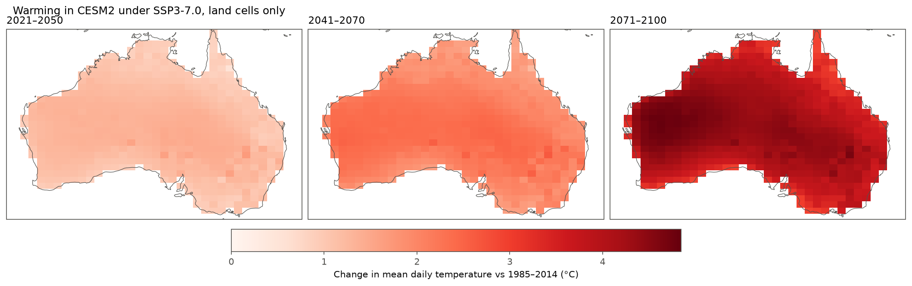
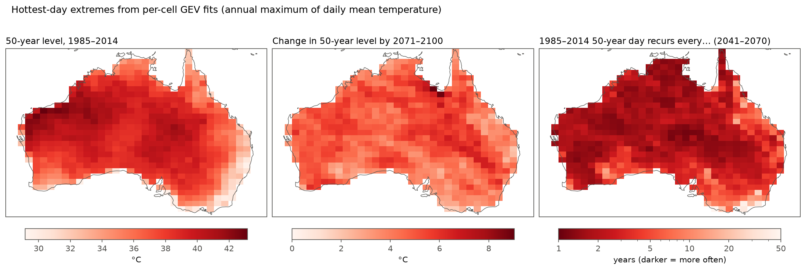
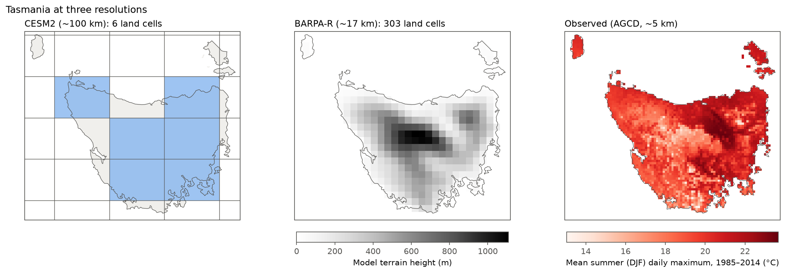
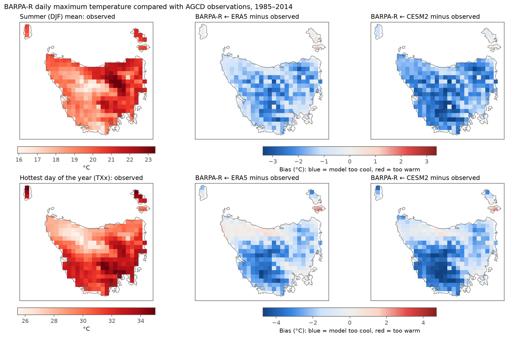

# Heat hazard in Australia under climate change

**A step-by-step CMIP6 screening: from a single model towards a defensible ensemble**

This project asks how extreme heat in Australia changes this century, and how much of the answer depends on the analysis choices. It starts from a deliberately simple single-model screening of the mainland (notebook 01), then zooms in on Tasmania with the Bureau of Meteorology's 17 km regional model, BARPA-R, tested against observations first (notebook 02). Later notebooks add more models and fix the remaining limitations one at a time.



## Headline results so far (notebook 01)

One model (NCAR CESM2), one high-emissions scenario (SSP3-7.0), daily *mean* temperature, Australian land cells, change relative to 1985–2014:

| | 1985–2014 | 2021–2050 | 2041–2070 | 2071–2100 |
|---|---|---|---|---|
| Land-mean warming (°C) | – | +1.2 | +2.1 | +4.1 |
| Days/year above the local 1985–2014 95th percentile | 18 | 37 | 53 | 94 |
| 1-in-50-year hottest daily mean, land average (°C) | 38.0 | 39.7 | 40.7 | 42.7 |
| How often the 1985–2014 1-in-50-year day recurs (median land cell) | 50 yr | ~4 yr | ~2 yr | ~1 yr |

These numbers are **not projections to plan with**. They come from a single simulation of a model known to sit at the warm end of CMIP6, and they describe a climate *hazard*, not risk to any asset or population. See [the limitations](notebooks/01_single_model_screening.ipynb) at the end of notebook 01.

<p align="center">
  
</p>

## Tasmania at 17 km (notebook 02)



BARPA-R driven by CESM2 r11 (the same global run as notebook 01), daily *maximum* temperature, Tasmanian land, relative to 1985–2014:

| | SSP1-2.6, 2071–2100 | SSP3-7.0, 2071–2100 |
|---|---|---|
| Warming of mean daily maximum (°C) | +2.1 | +3.9 |
| Days/year above the local 1985–2014 95th percentile (18 in 1985–2014) | 37 | 66 |
| Change in the 1-in-50-year hottest day, land average (°C) | +1.4 | +3.2 |

**First, the evaluation.** Compared with AGCD observations, BARPA-R runs about 1.2–1.7 °C too cool when driven by ERA5 and about 2 °C too cool when driven by CESM2, with the largest errors in the south-west and the highlands. The projections therefore use measures relative to the model's own climate, and observation-anchored values where absolute numbers are needed.

<p align="center">
  
</p>

## Notebooks

| # | Notebook | Question | Status |
|---|---|---|---|
| 01 | [Single-model screening](notebooks/01_single_model_screening.ipynb) | Mean warming, hot-day frequency and 50-year extremes in one CESM2 run | ✅ Done |
| 02 | [Tasmania with BARPA-R](notebooks/02_tasmania_barpa.ipynb) | Test the 17 km regional model against observations, then project heat hazard under SSP1-2.6 and SSP3-7.0 | ✅ Done |
| 03 | Regional ensemble | Repeat notebook 02 with all seven BARPA-R driving models to separate model spread from one model's behaviour | Planned |
| 04 | Fixing the method | Matching historical member for the mainland, quantile-mapping bias correction against AGCD, and a GEV that allows for warming within each window | Planned |

## Methods in brief

**Notebook 01 (mainland, CESM2):**

* **Land only, area-weighted.** Cells whose centre is on land (Natural Earth coastline), weighted by cos(latitude).
* **Equal 30-year windows.** 1985–2014 baseline; 2021–2050, 2041–2070 and 2071–2100 futures.
* **Frequency.** Days above each cell's 1985–2014 95th percentile, with the threshold held fixed.
* **Magnitude.** A stationary GEV fitted per cell and per window to the annual maximums of daily mean temperature. Results are the 50-year return level and the future return period of the baseline 50-year level.
* **Sampling uncertainty.** 1,000-sample bootstrap intervals for four reference city cells (Darwin, Alice Springs, Perth, Melbourne).

**Notebook 02 (Tasmania, BARPA-R):**

* **Three-way evaluation, 1985–2014.** AGCD observations (averaged from 5 km onto the 17 km grid) compared with BARPA-R driven by ERA5, which isolates the regional model's own error, and BARPA-R driven by CESM2, which adds the global model's error.
* **Bias-robust projections.** Changes relative to the model's own 1985–2014 climate, plus observation-anchored ("delta") 50-year levels for four places: Hobart, Launceston, Strahan and the Central Plateau.

The reusable functions live in [`src/heatrisk`](src/heatrisk) so that later notebooks use exactly the same methods.

## Run it yourself

```bash
conda env create -f environment.yml
conda activate heat-hazard
```

* **Notebook 01:** download the two CESM2 files described in [`data/README.md`](data/README.md) into `data/raw/`. Running it takes about three minutes.
* **Notebook 02:** run `python scripts/download_tasmania.py` (about 25 minutes, no account needed; it cuts Tasmania out on NCI's server). Running the notebook takes about five minutes.

## Repository layout

```
├── data/README.md        where the data come from (the data themselves are not in git)
├── figures/              figures written by the notebooks
├── notebooks/            the analysis, one question per notebook
├── scripts/              data download (Tasmania subsets from NCI THREDDS)
├── src/heatrisk/         loading, land masking, metrics and extreme-value helpers
├── environment.yml
└── pyproject.toml
```

## Licences and credits

* **Code:** MIT licence (see [LICENSE](LICENSE)).
* **Figures and derived numbers** follow the licences of the data behind them. Full citations are in [`data/README.md`](data/README.md).
  * Notebook 01 (figures 01–05): CESM2 output, [CC BY-SA 4.0](https://creativecommons.org/licenses/by-sa/4.0/).
  * Notebook 02: BARPA, [CC BY 4.0](https://creativecommons.org/licenses/by/4.0/). Figures 06 and 07 and the observation-anchored values also use AGCD observations, which are [CC BY-NC 4.0](https://creativecommons.org/licenses/by-nc/4.0/), so those are for **non-commercial use only**.
* The idea for this project came from exercises in the *Applied Climate Modelling & Climate Risk Accelerator* course. The analysis, code and text in this repository were written from scratch for it.

Dayan Sunny · [@dayansunny](https://github.com/dayansunny)
